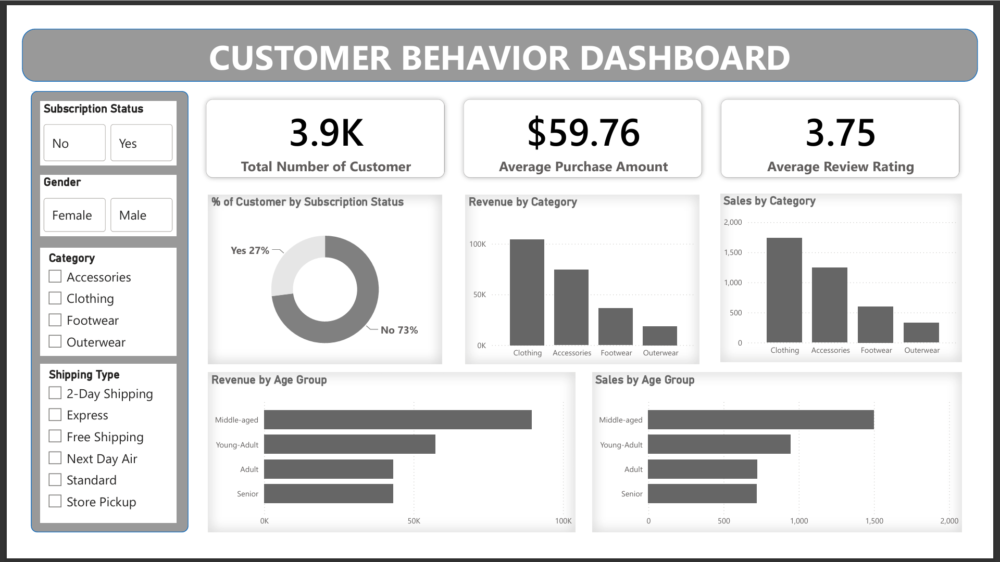

# 🛍️ Customer Shopping Behavior Analysis

## 📌 Project Overview

This project focuses on analyzing customer shopping behavior to understand purchasing patterns, customer preferences, spending trends, and subscription behavior.

The project uses a dataset containing **3,900 customer purchase records and 18 columns**. The analysis follows an end-to-end data analytics workflow, from data cleaning and preparation to SQL-based business analysis and interactive dashboard development in Microsoft Power BI.

The goal is to transform raw shopping data into meaningful insights and provide data-driven recommendations that can support business decision-making.

## 🎯 Project Objectives

* Understand customer purchasing behavior and spending patterns.
* Analyze revenue across customer demographics and age groups.
* Compare purchasing behavior between subscribers and non-subscribers.
* Identify highly rated and frequently purchased products.
* Analyze discount usage and customer purchasing decisions.
* Segment customers based on their purchase history.
* Build an interactive Power BI dashboard to communicate insights.
* Develop business recommendations based on the analysis.

## 🛠️ Tools and Technologies

| Tool               | Purpose                                              |
| ------------------ | ---------------------------------------------------- |
| Microsoft Excel    | Data cleaning, preparation, and feature engineering  |
| MySQL Workbench    | SQL queries, business analysis, and data aggregation |
| Microsoft Power BI | Interactive dashboard and data visualization         |
| Microsoft Word     | Project summary report                               |
| Gamma AI           | Presentation preparation                             |

## 📊 Dataset Overview

The dataset contains **3,900 purchase records and 18 columns** describing customer demographics, transaction details, product preferences, and shopping behavior.

### Key Attributes

* **Customer Demographics:** Age, Gender, Location, Subscription Status
* **Purchase Details:** Item Purchased, Category, Purchase Amount, Season
* **Product Information:** Size, Color, Review Rating
* **Shopping Behavior:** Discount Applied, Promo Code Used, Previous Purchases, Frequency of Purchases
* **Delivery Information:** Shipping Type

### Data Preparation

The following data preparation activities were performed as part of the project:

* Checked for missing values.
* Handled missing review ratings using median imputation.
* Created an `age_group` column to categorize customers by age.
* Created a `purchase_frequency_days` column.
* Examined the relationship between discount usage and promo code usage.
* Removed the redundant `promo_code_used` column, as documented in the analysis.
* Prepared the cleaned dataset for SQL analysis.

## 🔄 Project Workflow

### 1. Data Cleaning and Preparation — Microsoft Excel

Microsoft Excel was used to prepare the dataset for analysis.

Key activities included:

* Identifying and handling missing values.
* Creating additional analytical columns.
* Reviewing redundant or overlapping fields.
* Preparing a structured dataset for SQL Server.

### 2. Data Analysis — MySQL Workbench

MySQL Workbench was used to answer business questions through SQL queries, aggregations, comparisons, and customer segmentation.

#### Business Questions

1. **Revenue by Gender:** How does total revenue differ between male and female customers?
2. **High-Spending Discount Users:** Which customers used discounts but spent more than the average purchase amount?
3. **Top-Rated Products:** Which five products have the highest average review ratings?
4. **Shipping Type Analysis:** How do average purchase amounts compare between Standard and Express shipping?
5. **Subscription Analysis:** How do spending and revenue differ between subscribers and non-subscribers?
6. **Discount Dependency:** Which products have the highest percentage of discounted purchases?
7. **Customer Segmentation:** How can customers be classified as New, Returning, or Loyal based on purchase history?
8. **Product Popularity:** Which three products are purchased most frequently within each category?
9. **Repeat Buyers:** Are customers with more than five purchases more likely to subscribe?
10. **Revenue by Age Group:** How much revenue does each age group contribute?

## 📈 Power BI Dashboard

Microsoft Power BI was used to develop an interactive dashboard to present the findings of the customer shopping behavior analysis.

The dashboard is designed to make purchasing trends, customer preferences, and revenue patterns easier to understand through visualizations and summary metrics.

### Dashboard Features

* **Customer Overview:** Explore customer demographics and shopping behavior.
* **Revenue Analysis:** Examine purchase amounts and revenue distribution across available customer segments.
* **Product Analysis:** Review product categories, purchasing patterns, and product ratings.
* **Subscription Analysis:** Compare customer behavior by subscription status.
* **Discount Analysis:** Explore discount usage and its relationship with purchasing behavior.
* **Customer Segmentation:** Present customer groups based on purchase history.
* **Interactive Exploration:** Use available dashboard filters and slicers to explore the data by relevant categories.

### Key Performance Indicators (KPIs)

The dashboard can be used to present relevant metrics from the dataset, such as:

* Total Purchase Revenue
* Total Number of Purchase Records
* Average Purchase Amount
* Average Product Review Rating
* Customer Subscription Distribution
* Discount Usage Distribution

### Accessing the Power BI Dashboard

The Power BI dashboard file (`.pbix`) can be downloaded from the `PowerBI` folder in this repository, if included.

To open and interact with the dashboard, download the file and open it using Microsoft Power BI Desktop.

**Note:** A `.pbix` file stored on GitHub is a downloadable project file; it is not automatically an online, interactive dashboard. An online dashboard requires a separately published and appropriately shared Power BI report.

## 💡 Business Insights and Recommendations

The analysis supports recommendations in the following areas:

### 1. Subscription Growth

Evaluate subscription benefits and targeted promotions to encourage customers to subscribe.

### 2. Customer Loyalty

Consider loyalty programs and targeted engagement strategies to encourage repeat purchases.

### 3. Discount Strategy

Review discount usage across products and customer groups to better understand purchasing behavior and support effective promotional planning.

### 4. Product Promotion

Use product ratings and purchase frequency to identify products that may benefit from additional visibility.

### 5. Targeted Marketing

Use customer demographics and purchasing patterns to inform more relevant marketing campaigns.

## 📁 Repository Structure

The repository can be organized as follows:

```text
Customer-Shopping-Behavior-Analysis/
│
├── README.md
│
├── customer_shopping_behavior.csv
│
├── cleaned_dataset.xlsx
│
├── customer_analysis_queries.sql
│
├── customer_behavior_dashboard.pbix
│
├── project_summary_report.pdf
│
├── project_presentation.pdf
│
└── dashboard.png
```

## 🧠 Skills Demonstrated

* Data Cleaning and Preparation
* Exploratory Data Analysis
* Microsoft Excel
* MySQL Workbench and SQL Query Writing
* Data Aggregation and Comparison
* Customer Segmentation
* Microsoft Power BI
* Dashboard Development
* Data Visualization
* Business Analysis and Reporting

## 📦 Project Deliverables

The repository may include the following deliverables:

* Cleaned dataset and Excel preparation file
* SQL Server analysis queries
* Power BI dashboard file
* Project summary report in PDF format
* Gamma AI presentation exported as PDF
* Dashboard screenshots

## 🚀 Conclusion

This project demonstrates an end-to-end data analytics workflow using Microsoft Excel, SQL Server, and Power BI.

By preparing customer purchase data, investigating business questions, and visualizing findings in a dashboard, the project demonstrates how data analytics can support a better understanding of customer behavior and help businesses evaluate their marketing, subscription, product, and customer loyalty strategies.

## 👤 Author

**Kapil Pipariya**

Aspiring Data Analyst

* **GitHub:** [Add your GitHub profile URL]
* **LinkedIn:** [Add your LinkedIn profile URL]

---

⭐ Thank you for visiting my project repository!
